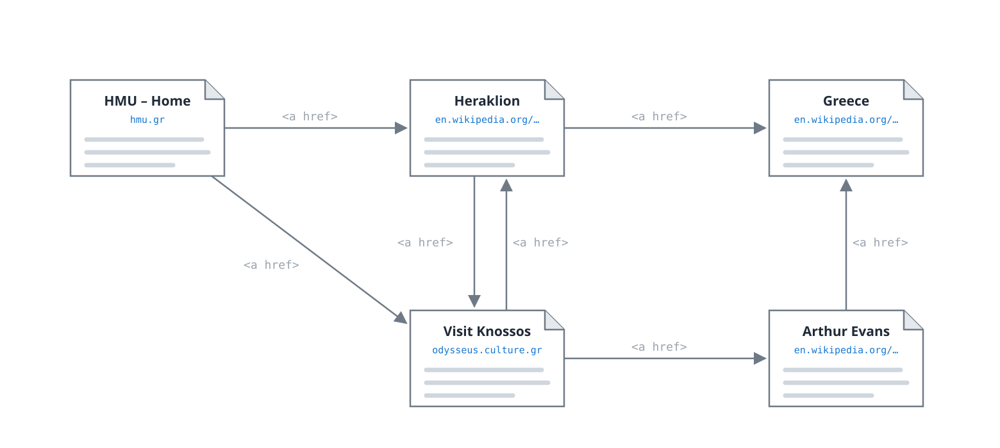
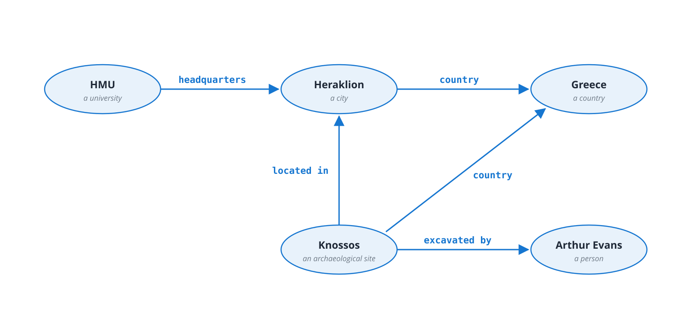

# One Question, Three Sources

You are building an app for Erasmus students

&ldquo;Show me archaeological sites within 30 km of my university that are open on Sunday.&rdquo;

## What the app has to combine
- Where is **my university**? &rarr; a university registry
- Which places are **archaeological sites**, and where? &rarr; e.g. Wikidata
- When are they **open**? &rarr; e.g. OpenStreetMap
- No single document contains the answer

## Why not just&hellip;
- **search the web?** You get pages *about* Knossos &ndash; reading and combining them is still your job
- **ask an LLM?** A fluent answer &ndash; but no sources; sites, distances or opening hours may be **outdated or invented**

Applications need facts they can <strong>combine</strong> and <strong>check</strong>: things with global names, relations with explicit meaning.

Note:
Optional live opener: ask a chatbot the question, then ask it for the Wikidata IDs of the
sites it listed and open one of them -- often the ID belongs to something else. The question
comes back twice: the map query in Part 02 (all archaeological sites in the Crete Region)
and the closing slide on LLM + SPARQL.

---

# Web of Documents vs. Web of Data

## World Wide Web
- The unit is a **document**
- Links go from page to page
- Meaning is implicit &ndash; in the text, **for humans**
- HTTP, URL, HTML

## Web of Data
- The unit is a **statement about a thing**
- Links go from thing to thing
- Meaning is explicit &ndash; **for machines**
- HTTP, IRI, **RDF**, **SPARQL**

Berners-Lee, T., Hendler, J., Lassila, O.: <strong>The Semantic Web.</strong> <em>Scientific American</em> 284(5), 34&ndash;43 (2001)

---

# Web of Documents: Pages and Links

- Nodes are **pages**, edges are **hyperlinks** &ndash; and every link says just &ldquo;see this&rdquo;
- *Why* does the HMU page link to Heraklion? Only a human reading the text knows.

---

# Web of Data: Things and Predicates

- Nodes are the **things themselves** &ndash; not pages about them
- Every edge has a **name**: a machine can ask &ldquo;what is *located in* Heraklion?&rdquo; or &ldquo;who *excavated* Knossos?&rdquo;

Note:
Flip back and forth between the two slides: same layout, same subjects. On the left the
links are anonymous; on the right each edge carries its meaning.

---

# 25 Years Later

## Promised in 2001
- Autonomous software agents negotiating your appointments
- Logic, proofs, a &ldquo;web of trust&rdquo;

## What we actually got
- **RDF**, **SPARQL**, **JSON-LD**, shared vocabularies
- Renamed: **knowledge graphs** (Google, 2012)
- Wikidata: **100+ million things**, billions of facts, free to query
- The agents? They came as **LLMs** &ndash; we'll meet one today

The <em>vision</em> failed, the <em>technology</em> quietly won.

Note:
Google's 2012 blog post "Things, not strings" coined the popular name. Today every large
company has a knowledge graph somewhere: search, e-commerce, recommendation, biomedicine.
