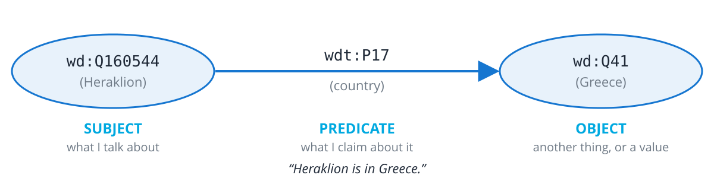
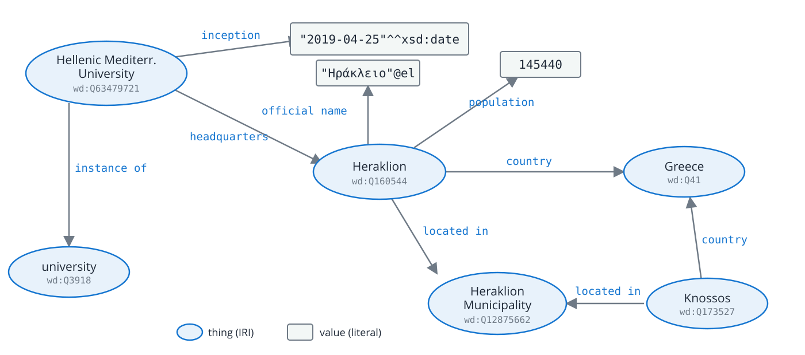

<!-- .slide: class="section" -->

<header>
    <p class="eyebrow">Part 01</p>
    <h1>Knowledge Graphs in Ten Minutes</h1>
    <p>Things, not strings: how to write down facts so that a machine can use them</p>
</header>

---

# Machine-Readable != Machine-Understandable

Three rental websites export their offers as XML:

<div class="small">

| Site A | Site B | Site C |
|---|---|---|
| `<size>2</size>` | `<size>65</size>` | `<size>65 m2</size>` |
| number of bedrooms | floor area, a number | floor area with a unit |

</div>

- The **meaning** of `<size>` lives in somebody's code, not in the data
- Every integration = reading docs + writing a converter
- And what is `<location>Heraklion</location>`? The city? The municipality? The regional unit? A hotel named *Heraklion*?

<div class="callout">
We need two things: <strong>global names for things</strong> and <strong>shared meaning of properties</strong>.
</div>

Note:
Students know this pain from any API integration. The data is perfectly parseable
(machine-readable), but the machine has no idea what it means.

---

# Step 1: Give Everything a Global Name

- Every thing gets an **IRI** &ndash; a URL-like identifier (generalised URL, Unicode allowed)
    - Heraklion: [`http://www.wikidata.org/entity/Q160544`](http://www.wikidata.org/entity/Q160544)
        - or [`http://dbpedia.org/resource/Heraklion`](http://dbpedia.org/resource/Heraklion)
    - Greece: [`http://www.wikidata.org/entity/Q41`](http://www.wikidata.org/entity/Q41)
        - or [`http://dbpedia.org/resource/Greece`](http://dbpedia.org/resource/Greece)
- Not just pages: **cities, people, books, properties, concepts**
- Prefixes keep it readable: `wd:Q160544` = `http://www.wikidata.org/entity/Q160544`

<div class="col">

## Where do IRIs come from?
- **My data** &rarr; my own domain, e.g. `https://fit.vut.cz/student/938272`
- **Well-known things** &rarr; reuse public knowledge bases (Wikidata, DBpedia)

</div>
<div class="col">

## Linked Data rule of thumb
- Use **HTTP** IRIs
- When someone opens one, **return useful data**
- **Link to other people's IRIs**

</div>

<div style="clear: both"></div>

Note:
Open https://www.wikidata.org/wiki/Q160544 in the browser -- the IRI really works,
you get a page for humans or RDF for machines (content negotiation).

=--

# Short IRIs: Prefixes

<span class="kicker">Nobody wants to type <code>http://www.wikidata.org/entity/</code> a hundred times</span>

<div class="col small">

## Namespace + local name

<p style="text-align: center; font-family: monospace; font-size: 90%;">
<span style="color: #1676d0">http://www.wikidata.org/entity/</span><strong>Q160544</strong><br>
&darr;<br>
<span style="color: #1676d0">wd:</span><strong>Q160544</strong>
</p>

- Declare the prefix **once** at the top of the file:
    - Turtle: `@prefix wd: <http://www.wikidata.org/entity/> .`
    - SPARQL: `PREFIX wd: <http://www.wikidata.org/entity/>`
- Just **shorthand**: the data always contains the full IRI
- The name `wd:` is a convention &ndash; pick any, look up common ones at [prefix.cc](https://prefix.cc/)

</div>
<div class="col small">

| prefix | namespace | used for |
|---|---|---|
| `wd:` | `http://www.wikidata.org/entity/` | Wikidata items |
| `wdt:` | `http://www.wikidata.org/prop/direct/` | Wikidata properties |
| `rdf:` | `http://www.w3.org/1999/02/22-rdf-syntax-ns#` | RDF core (`rdf:type`) |
| `schema:` | `https://schema.org/` | schema.org |
| `dbr:` | `http://dbpedia.org/resource/` | DBpedia |

</div>

<div style="clear: both"></div>

Note:
The Wikidata and DBpedia query services pre-declare their common prefixes -- that's why
the queries later in the lecture have no PREFIX lines. In a plain file or a local triple
store you must declare them yourself.

---

# Step 2: Statements as Triples



- **RDF** (Resource Description Framework): every fact is a **subject &ndash; predicate &ndash; object** triple
- Subject and predicate are always IRIs; the object is an IRI or a **literal** (string, number, date)
- Anybody can publish triples about anything

---

# Triples Make a Graph



- Triples sharing an IRI **connect automatically** &ndash; no foreign keys, no schema migration
- Literals can carry a **language** (`@el`) or a **datatype** (`^^xsd:date`)

Note:
All of these facts are real Wikidata statements (checked November 2026). "instance of" is
Wikidata's own wdt:P31; the standard RDF equivalent is rdf:type. Point out that
the university and Knossos were described by different people at different times, yet
they join through Heraklion for free.

---

# Writing It Down: Turtle

<span class="kicker">The same graph written in text</span>

<div class="xsmall">

```turtle
@prefix wd:  <http://www.wikidata.org/entity/> .
@prefix wdt: <http://www.wikidata.org/prop/direct/> .
@prefix xsd: <http://www.w3.org/2001/XMLSchema#> .

wd:Q63479721                       # HMU
    wdt:P31   wd:Q3918 ;           # instance of: university
    wdt:P159  wd:Q160544 ;         # headquarters: Heraklion
    wdt:P571  "2019-04-25"^^xsd:date .  # inception

wd:Q160544                         # Heraklion
    wdt:P17   wd:Q41 ;             # country: Greece
    wdt:P131  wd:Q12875662 ;       # located in: Heraklion Mun.
    wdt:P1082 145440 ;             # population
    wdt:P1448 "Ηράκλειο"@el .      # official name

wd:Q173527                         # Knossos
    wdt:P17   wd:Q41 ;
    wdt:P131  wd:Q12875662 .
```

</div>

---

# Turtle Syntax

- One statement = `subject predicate object .`
- `;` repeats the subject, `,` repeats subject and predicate
- `#` starts a comment &ndash; Wikidata IDs are not meant to be read by humans

Adding my own facts? One more prefix:

```turtle
@prefix schema: <https://schema.org/> .
@prefix ex:     <https://example.org/my-erasmus/> .

ex:me  a  schema:Person ;        # a = rdf:type
       ex:visited  wd:Q160544 , wd:Q173527 .
```

- Three vocabularies, three owners &ndash; **nobody had to agree in advance**
- Same graph can be written as **JSON-LD** (we'll see it in web pages) or N-Triples

Note:
This is the only syntax slide. Left: exactly the 9 edges of the previous picture.
Right: the point that anyone can extend the graph with their own namespace.

---

# Vocabularies (a.k.a. Ontologies)

<!-- <span class="kicker">Who decides what <code>schema:worksFor</code> means?</span> -->

<div class="col">

## Reuse first
- **[schema.org](https://schema.org/)** &ndash; people, places, products, events, recipes&hellip; the vocabulary of the web
- **Wikidata properties** &ndash; `wdt:P17` country, `wdt:P1082` population, &hellip; 12 000+
- **Dublin Core** (documents), **FOAF** (people), **GeoSPARQL** (geometry), **SKOS** (taxonomies)

</div>
<div class="col">

## &hellip;define your own if you must
- An ontology is just **more RDF**: classes, properties, how they relate
- Languages for it: RDFS, OWL (we skip the details today)
- We will see a **custom ontology** at the end &ndash; for describing rendered web pages
- Search: [Linked Open Vocabularies](https://lov.linkeddata.es/dataset/lov/)

</div>

<div style="clear: both"></div>

<div class="result">
Every reused term is a term that other people's software <strong>already understands</strong>.
</div>
