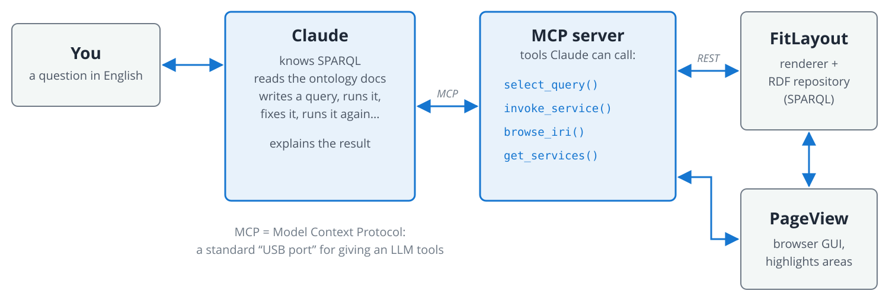

<!-- .slide: class="section" -->

<header>
    <p class="eyebrow">Bonus &middot; Our research</p>
    <h1>Chatting with a Web Page</h1>
    <p>Turning any rendered page into a knowledge graph &ndash; and letting an AI write the queries</p>
</header>

---

# FitLayout: A Web Page as a Graph


**FitLayout** (our open-source framework) renders a page in a headless browser and describes **what it looks like** in RDF:

- **Boxes** &ndash; every rendered element with position, size, font, colour
- **Visual areas** &ndash; blocks a human would perceive (name, phone, menu&hellip;)
- **Spatial relations** &ndash; `above`, `below`, `leftOf`, `rightOf`
- **Tags** &ndash; labels such as *e-mail*, *phone*, *room* (for machine learning)

<div class="callout small">
Example: a staff page at FIT BUT &ndash; no JSON-LD, yet <em>&ldquo;E-mail&rdquo;</em> is <strong>left of</strong> the address, the graph says so.
</div>

<div style="clear: both"></div>

Note:
The picture: green rectangles = visual areas, lines = spatial relations between them
(here only left/right/above/below). This is what lets us work with the long tail of the
web that has no JSON-LD. Used in our ICWE 2026 paper as a dataset for graph neural networks.

---

# Our Own Vocabulary (Ontology)

No existing vocabulary describes *rendered boxes and their positions* &ndash; so we defined one (`box:`, `segm:`).

```turtle
r:art1450#a124  a  segm:Area ;               # the e-mail address on the page
    segm:text         "burgetr@fit.vut.cz" ;
    box:fontSize      14.0 ;
    box:underline     1.0 ;
    box:bounds        r:art1450#a124-rect-b ;
    segm:belongsTo    r:art1450 ;               # the area tree of the page
    segm:isChildOf    r:art1450#a121 ;          # parent area
    segm:containsBox  r:art22#b488 ;            # the rendered <td>
    segm:hasTag       r:tag-person--email ;     # label for machine learning
    segm:isInRelation r:rd-art1450-a124-rightOf-a122 .

r:art1450#a124-rect-b  box:positionX 443 ; box:positionY 992 ;
                       box:width 121 ;     box:height 18 .

r:rd-art1450-a124-rightOf-a122               # "is right of the E-mail label"
    segm:hasRelationType r:rel-rightOf ;
    segm:hasRelatedRect  r:art1450#a122 ;       # the area with text "E-mail"
    segm:support         101.0 .
```
<!-- .element style="height: 20em; overflow: scroll" -->

- It is **still RDF**: the same Turtle, the same SPARQL, the same tools as for Wikidata

<div class="callout small">
The catch: nobody knows <code>segm:isInRelation</code> by heart. Writing queries by hand is tedious.
</div>

Note:
Real data from our repository: page r:art22 (https://www.fit.vut.cz/person/10467/),
area tree r:art1450. Ontology: http://fitlayout.github.io/ontology/

=--

# PageView: The Same Area in the GUI

 <!-- .element: style="height:760px; display:block; margin:0 auto; border:1px solid #d8dee4; border-radius:6px;" -->

---

# Let Claude Write the SPARQL



- Claude gets the **ontology documentation** and a tool to **run SPARQL**
- It writes a query, looks at the result, **corrects itself** if needed
- It can even render a new page or **highlight** the answer in the browser

Note:
Our MCP server is ~200 lines of Python (FastMCP). The key ingredient is not the code, it's
the ontology description (a markdown file) that tells the model how the data is shaped
and which query patterns work best.

---

<!-- .slide: class="normal" -->

# Live Demo

<span class="kicker">Ask a staff page anything</span>

<div class="col small">

## Suggested questions
1. &ldquo;What is this page about?&rdquo;
2. &ldquo;What is the largest text on the page?&rdquo;
3. &ldquo;What is the e-mail, phone and room of this person?&rdquo;
4. &ldquo;Highlight the phone number in the browser.&rdquo;
5. &ldquo;Render the page of another colleague and find their room.&rdquo;

</div>
<div class="col small">

## Watch for
- The **SPARQL** Claude generates
- How it **uses the ontology** (areas, relations, tags)
- When it **fixes** its own query

</div>

<div style="clear: both"></div>

Note:
Backup slides below (DOWN arrow) in case the live setup fails.
Before the lecture: start FitLayout server locally, check the MCP endpoint
(http://localhost:8765/mcp), check the PageView extension is connected, and make sure
the repository contains the staff page (page r:art22, area tree r:art1450).

=--

# Backup: &ldquo;What Is the Largest Text?&rdquo;

<div class="col small">

**Claude's query**

```sparql
PREFIX box:  <http://fitlayout.github.io/ontology/render.owl#>
PREFIX segm: <http://fitlayout.github.io/ontology/segmentation.owl#>
PREFIX r:    <http://fitlayout.github.io/resource/>

SELECT DISTINCT ?text ?size WHERE {
  ?area segm:belongsTo r:art1450 ;
        box:fontSize   ?size ;
        segm:text      ?text .
  FILTER(STRLEN(?text) > 0)
}
ORDER BY DESC(?size)
LIMIT 5
```

</div>
<div class="col small">

**Result**

| text | size |
|---|---|
| BURGET | 30.0 |
| RADEK | 30.0 |
| RADEK BURGET | 30.0 |
| CONTACT | 28.0 |
| Department of Information Systems | 24.0 |

- The largest text is the **person's name** &ndash; split into two leaf areas plus their parent
- Then the section heading and the department

</div>

<div style="clear: both"></div>

Note:
Results verified on the live repository (November 2026). The triple "RADEK / BURGET /
RADEK BURGET" is a nice moment to explain the area tree: a parent area collects the text
of its children.

=--

# Backup: &ldquo;E-mail, Phone and Room?&rdquo;

<div class="col small">

**Claude's query** &ndash; follows the spatial relations

```sparql
PREFIX segm: <http://fitlayout.github.io/ontology/segmentation.owl#>
PREFIX r:    <http://fitlayout.github.io/resource/>

SELECT ?label ?value WHERE {
  ?l   segm:belongsTo r:art1450 ;
       segm:text ?label ;
       segm:isInRelation ?rel .
  ?rel segm:hasRelationType r:rel-leftOf ;
       segm:hasRelatedRect  ?v .
  ?v   segm:text ?value .
  FILTER(?label IN ("E-mail", "Work Phone", "Room"))
}
```

</div>
<div class="col small">

**Result**

| label | value |
|---|---|
| E-mail | burgetr@fit.vut.cz |
| Work Phone | +420 54114 1320 |
| Room | C215 Office |

- No pixel arithmetic: the **graph already knows** that the label is *left of* the value
- Claude found `r:rel-leftOf` in the ontology docs, not in its training data

</div>

<div style="clear: both"></div>

Note:
Results verified on the live repository (November 2026). Alternative route for the same
answer: the areas tagged r:tag-person--email / --phone / --room.

---

# Why Does This Work?

<div class="col">

## Claude is good at
- SPARQL syntax and idioms (aggregates, paths, `OPTIONAL`, `FILTER`)
- Reading a **schema description** and following it
- **Trial and error**: run, inspect, refine

</div>
<div class="col">

## &hellip;as long as it can check
- Without a tool, an LLM asked for a Wikidata query may **invent** a plausible-looking `wdt:P…` or `wd:Q…`
- With an endpoint, wrong IDs show up as **empty results** and get fixed

</div>

<div style="clear: both"></div>

<div class="result">
Knowledge graph = <strong>explicit, checkable facts</strong>. LLM = <strong>natural-language interface</strong>. Together they cover each other's weaknesses.
</div>

Note:
Optional live contrast if time allows: ask a plain chat "SPARQL for archaeological sites
in Crete" and compare the IDs to the ones on our earlier slide.
