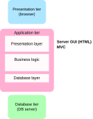
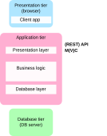

# Klientská strana IS

- **Tenký klient** -- prohlížeč
   - Zobrazuje HTML generované serverem, odesílá GET a POST požadavky (formuláře)
   - Prezentační logika (chování UI) **na serverové straně**
- **Tlustý klient** -- aplikace (webová, mobilní, ...)
   - Volá funkce aplikačního rozhraní (např. REST)
   - Prezentační logika (chování UI) **na klientské straně**
   - Webová varianta: _Single Page Application_ (SPA)

---

<!-- .slide: class="normal centered" data-transition="slide-in fade-out" -->

# Vrstvy aplikace – serverové GUI

 <!-- .element: style="height: 700px; text-align: center" -->

---

<!-- .slide: class="normal centered" data-transition="fade-in slide-out" -->

# Vrstvy aplikace – klient v JS a API

 <!-- .element: style="height: 700px; text-align: center" -->

---

# Hybridní přístupy

- Hranice mezi tenkým a tlustým klientem se dnes stírá
- **Server-side rendering** (SSR) + _hydratace_
  - První zobrazení stránky vygeneruje server (rychlé načtení, indexace)
  - V prohlížeči pak stránku „oživí“ JS aplikace
  - Např. _Next.js_ (React), _Nuxt_ (Vue), _SvelteKit_
- **Hypermedia** přístup
  - Server vrací přímo útržky HTML, klient je jen vkládá do stránky
  - Minimum JavaScriptu na klientovi, logika zůstává na serveru
  - Např. knihovna [htmx](https://htmx.org/)
